# The Complete Scikit-Learn Masterclass: From Beginner to Machine Learning Practitioner

> **Target Audience:** Developers, data enthusiasts, and engineers transitioning into Machine Learning.  
> **Pedagogical Philosophy:** Zero unexplained magic. Every algorithm, mathematical metric, and preprocessing step is accompanied by:
>
> 1. **What is it?** (Clear definition in plain English)
> 2. **Why is it needed?** (The exact software engineering & data problem it solves)
> 3. **The Intuitive Analogy** (Everyday mental model)
> 4. **A Real-World Scenario** (What happens if you omit or misuse it)
> 5. **Visual Architecture Diagram** (Mermaid flowcharts & schemas)
> 6. **Complete, Self-Contained Python Code** (Ready to copy, run, and modify)

---

## Visual Roadmap: The Machine Learning Journey

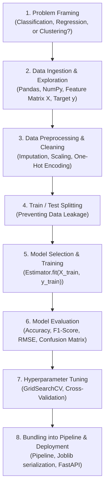

---

## Master Glossary: Machine Learning & Scikit-Learn Terms

| Term | What Is It? | Why Is It Needed? |
| :--- | :--- | :--- |
| **Scikit-Learn (`sklearn`)** | The standard Python library for classical Machine Learning built on NumPy, SciPy, and Matplotlib. | Provides a unified, highly optimized, and standardized API for preprocessing, modeling, and evaluation. |
| **Feature Matrix ($X$)** | A 2D array or DataFrame of shape `(n_samples, n_features)` containing input measurements. | Feeds the observational inputs (e.g., house size, age, bedrooms) into the machine learning algorithm. |
| **Target Vector ($y$)** | A 1D array or Series of length `n_samples` containing the ground truth labels or continuous values. | The quantity the model learns to predict (e.g., house price or disease status). |
| **Estimator** | Any Scikit-Learn object that learns from data via the `.fit()` method. | Unifies hundreds of different algorithms under one single interface. |
| **Transformer** | An estimator that modifies or cleans data using `.transform()` or `.fit_transform()`. | Used for data preprocessing: scaling numbers, filling NaNs, encoding text categories. |
| **Predictor** | An estimator capable of making predictions using `.predict()` or `.predict_proba()`. | Turns unseen features into expected labels or numeric values. |
| **Supervised Learning** | Training a model on data where the true answer ($y$) is already provided. | Used when you have historical records with known outcomes. |
| **Unsupervised Learning** | Discovering hidden patterns, groupings, or structures in data without target labels. | Used for customer segmentation, anomaly detection, and data visualization. |
| **Data Leakage** | Accidentally sharing information from test data with the training phase. | Creates artificially inflated training scores that collapse in production. |
| **Pipeline** | A chain of transformers followed by a final estimator executed sequentially. | Prevents data leakage, guarantees reproducibility, and simplifies deployment. |

---

## 1. What Is Scikit-Learn & When Should You Use It?

### Classical ML vs Deep Learning vs LLMs

Modern AI spans several distinct paradigms. Understanding when to use Scikit-Learn versus Deep Learning (PyTorch/TensorFlow) or Generative AI (LLMs) is crucial:

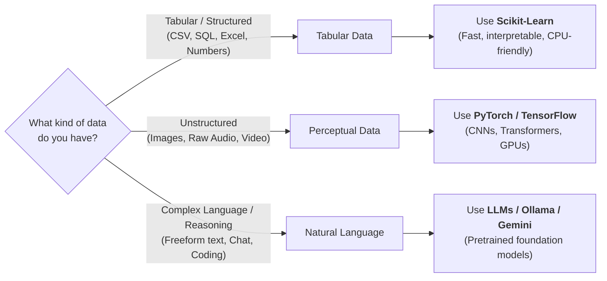

| Criteria | Scikit-Learn (Classical ML) | Deep Learning (PyTorch / TF) | Large Language Models (LLMs) |
| :--- | :--- | :--- | :--- |
| **Primary Data Type** | Tabular, numeric, customer records, sensor data | Images, audio, high-dimensional tensors | Text, code, conversation, reasoning |
| **Data Volume Needed** | Hundreds to hundreds of thousands of rows | Hundreds of thousands to millions of rows | Billions of tokens (pre-trained) |
| **Hardware Required** | Standard laptop CPU (minimal RAM) | Powerful dedicated GPUs (CUDA) | Cloud APIs or high-RAM local GPUs |
| **Interpretability** | High (coefficients, feature importances) | Low (black-box neural network weights) | Variable (prompts, chain-of-thought) |
| **Training Time** | Milliseconds to minutes | Hours to days | Pre-trained; fine-tuning takes hours |

---

## 2. The Core Scikit-Learn API Design Pattern

Every single algorithm in Scikit-Learn adheres to a clean, consistent object-oriented interface. Once you master this pattern, you can use **any** model in the library without relearning syntax.

### The Unified Interface

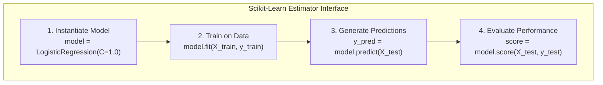

### The Three Core Method Families

1. **`fit(X, y=None)`**: Learns parameters from data.
   - For a scaler: computes the mean and standard deviation.
   - For a classifier: finds the optimal decision boundary weights.
2. **`transform(X)`**: Modifies input data using previously learned parameters (Transformers only).
   - Scales features, fills missing values, or reduces dimensionality.
   - **`fit_transform(X)`**: Combines `fit` and `transform` in one optimized step for training data.
3. **`predict(X)`**: Generates output predictions on new, unseen feature matrices (Predictors only).
   - **`predict_proba(X)`**: Returns probability estimates for each class (e.g., `[0.15, 0.85]`).

> [!IMPORTANT]
> **Golden Rule of ML:**
> Never call `.fit()` or `.fit_transform()` on your test set! You must `fit` **only** on the training set, and then use `.transform()` or `.predict()` on the test set. Fitting on the test set causes **Data Leakage**.

---

## 3. The Machine Learning Taxonomy

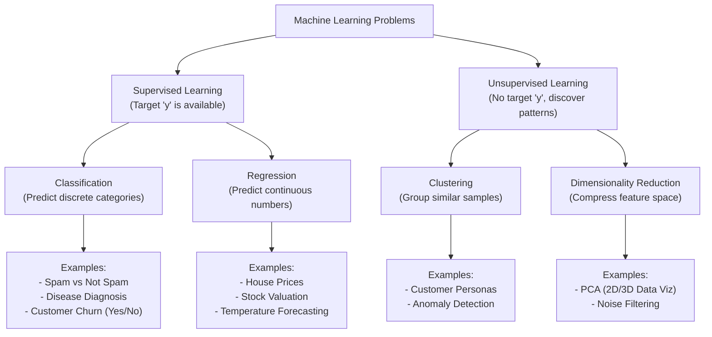

---

## 4. Setting Up & Loading Datasets

Scikit-Learn bundles classic toy datasets and synthetic data generators for immediate experimentation.

### Installing Scikit-Learn

```bash
# Create a virtual environment and install standard ML packages
python3 -m venv .venv
source .venv/bin/activate  # On Windows: .venv\Scripts\activate
pip install scikit-learn pandas numpy matplotlib seaborn
```

### Exploring Built-in Datasets

```python
import numpy as np
import pandas as pd
from sklearn.datasets import load_iris, fetch_california_housing

# 1. Classification Dataset: Iris Flowers (3 flower species, 4 measurements)
iris = load_iris(as_frame=True)
df_iris = iris.frame
print("=== Iris Dataset (First 3 rows) ===")
print(df_iris.head(3))
print(f"Target classes: {iris.target_names}\n")

# 2. Regression Dataset: California Housing Prices
housing = fetch_california_housing(as_frame=True)
df_housing = housing.frame
print("=== California Housing (First 3 rows) ===")
print(df_housing.head(3))
print(f"Features: {housing.feature_names}")
```

---

## 5. Data Preprocessing & Feature Engineering

Real-world datasets are never ready for machine learning out-of-the-box. They contain missing values (`NaN`), text labels, and features on completely different numerical scales.

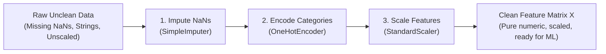

### 5.1 Train / Test Splitting

Before altering data, split it into a **Training Set** (used to learn patterns) and a **Test Set** (held back to evaluate real-world generalization).

```python
from sklearn.model_selection import train_test_split

X = df_iris.drop(columns=["target"])
y = df_iris["target"]

# 80% training data, 20% test data
# stratify=y ensures target class proportions are preserved in both splits
X_train, X_test, y_train, y_test = train_test_split(
    X, y, test_size=0.2, random_state=42, stratify=y
)

print(f"Training samples: {X_train.shape[0]}, Test samples: {X_test.shape[0]}")
```

### 5.2 Handling Missing Values (`SimpleImputer`)

Machine learning algorithms require numbers, not `NaN` or `None`.

```python
from sklearn.impute import SimpleImputer
import numpy as np

# Sample messy data with missing values (np.nan)
raw_features = np.array([
    [25.0, 50000.0],
    [np.nan, 62000.0],
    [32.0, np.nan],
    [45.0, 110000.0]
])

# Strategy can be: 'mean', 'median', 'most_frequent', or 'constant'
imputer = SimpleImputer(strategy="median")

# Learn median from training data, then fill missing spots
imputed_features = imputer.fit_transform(raw_features)
print("=== Imputed Features (No more NaNs) ===")
print(imputed_features)
```

### 5.3 Feature Scaling (`StandardScaler` vs `MinMaxScaler`)

Algorithms that compute geometric distances or gradients (e.g., Logistic Regression, SVM, KNN, Neural Networks) fail when one feature ranges from $0$ to $1$ (e.g., Age/100) and another ranges from $10,000$ to $1,000,000$ (e.g., Salary). The larger feature completely dominates.

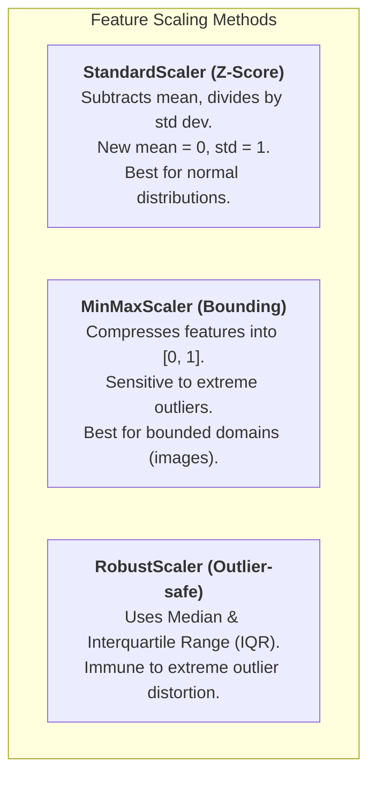

```python
from sklearn.preprocessing import StandardScaler, MinMaxScaler

data = np.array([
    [18.0, 15000.0],
    [35.0, 65000.0],
    [60.0, 180000.0]
])

scaler = StandardScaler()
scaled_data = scaler.fit_transform(data)

print("=== Standardized Data (Mean ~ 0, Variance = 1) ===")
print(scaled_data)
```

### 5.4 Categorical Encoding (`OneHotEncoder`)

Algorithms cannot do arithmetic on strings like `"Red"`, `"Blue"`, `"Green"`.

> [!WARNING]
> Do NOT use simple integer labels (`Red=1`, `Blue=2`, `Green=3`) for unordered categories! The algorithm will assume `Green (3)` is mathematically 3x greater than `Red (1)`. Use **One-Hot Encoding** instead.

```python
from sklearn.preprocessing import OneHotEncoder
import pandas as pd

cities = pd.DataFrame({"city": ["London", "Tokyo", "Paris", "London"]})

# handle_unknown='ignore' prevents crashes if a brand-new city appears in test data
ohe = OneHotEncoder(sparse_output=False, handle_unknown="ignore")
encoded_cities = ohe.fit_transform(cities)

print("=== One-Hot Encoded City Columns ===")
print(pd.DataFrame(encoded_cities, columns=ohe.get_feature_names_out(["city"])))
```

### 5.5 Composing Pipelines with `ColumnTransformer`

In production, you have a mixture of numerical and categorical columns. `ColumnTransformer` applies different transformations to each column type simultaneously:

```python
from sklearn.compose import ColumnTransformer
from sklearn.preprocessing import StandardScaler, OneHotEncoder
from sklearn.impute import SimpleImputer
from sklearn.pipeline import Pipeline

# Sample customer profile dataset
customers = pd.DataFrame({
    "age": [25.0, np.nan, 45.0, 33.0],
    "income": [50000.0, 75000.0, 120000.0, np.nan],
    "membership": ["silver", "gold", "gold", "bronze"]
})

num_cols = ["age", "income"]
cat_cols = ["membership"]

# Numeric pipeline: Impute missing values with median, then standardize
num_pipeline = Pipeline([
    ("imputer", SimpleImputer(strategy="median")),
    ("scaler", StandardScaler())
])

# Categorical pipeline: Impute missing values with constant, then one-hot encode
cat_pipeline = Pipeline([
    ("imputer", SimpleImputer(strategy="most_frequent")),
    ("encoder", OneHotEncoder(handle_unknown="ignore", sparse_output=False))
])

# Combine both through ColumnTransformer
preprocessor = ColumnTransformer(transformers=[
    ("num", num_pipeline, num_cols),
    ("cat", cat_pipeline, cat_cols)
])

processed = preprocessor.fit_transform(customers)
print("=== Clean, Ready-to-Train Feature Matrix ===")
print(processed)
```

---

## 6. Supervised Learning: Classification

Classification predicts a categorical label (e.g., benign vs malignant tumor, transaction fraud vs normal).

### 6.1 Core Classification Algorithms Explained

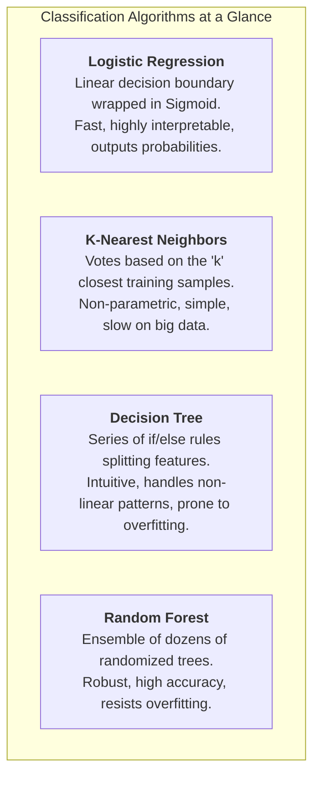

### 6.2 End-to-End Classification Example

Let's build a binary classifier to predict whether a breast tumor is malignant or benign.

```python
from sklearn.datasets import load_breast_cancer
from sklearn.model_selection import train_test_split
from sklearn.ensemble import RandomForestClassifier
from sklearn.metrics import classification_report, confusion_matrix

# 1. Load data
cancer = load_breast_cancer()
X, y = cancer.data, cancer.target

# 2. Train-test split (80% train, 20% test)
X_train, X_test, y_train, y_test = train_test_split(
    X, y, test_size=0.2, random_state=42, stratify=y
)

# 3. Instantiate and train model
clf = RandomForestClassifier(n_estimators=100, random_state=42)
clf.fit(X_train, y_train)

# 4. Generate predictions
y_pred = clf.predict(X_test)
y_proba = clf.predict_proba(X_test)[:, 1]  # Probability of class 1

# 5. Evaluate
print("=== Model Performance ===")
print(classification_report(y_test, y_pred, target_names=cancer.target_names))
```

### 6.3 Understanding Evaluation Metrics: Accuracy vs Precision vs Recall

Why is **Accuracy** often a dangerous metric?  
If $99\%$ of credit card transactions are legitimate and $1\%$ are fraudulent, a dumb model that predicts "Legitimate" $100\%$ of the time achieves **$99\%$ accuracy**, while catching zero fraud!

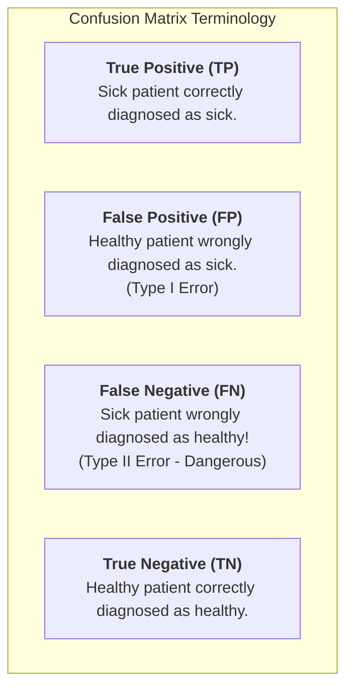

$$\text{Precision} = \frac{\text{TP}}{\text{TP} + \text{FP}} \quad \text{(When model predicts positive, how often is it right?)}$$

$$\text{Recall} = \frac{\text{TP}}{\text{TP} + \text{FN}} \quad \text{(Out of all actual positives, how many did the model catch?)}$$

$$\text{F1-Score} = 2 \times \frac{\text{Precision} \times \text{Recall}}{\text{Precision} + \text{Recall}} \quad \text{(Harmonic mean balancing both)}$$

- **High Precision Required:** Spam filtering (You don't want an important email sent to Spam).
- **High Recall Required:** Cancer diagnosis or fraud detection (Missing a sick patient is catastrophic).

```python
from sklearn.metrics import confusion_matrix, ConfusionMatrixDisplay
import matplotlib.pyplot as plt

cm = confusion_matrix(y_test, y_pred)
print("=== Confusion Matrix ===")
print(cm)
```

---

## 7. Supervised Learning: Regression

Regression predicts continuous numerical values (e.g., housing prices, temperature, delivery time).

### 7.1 Regression Algorithms Overview

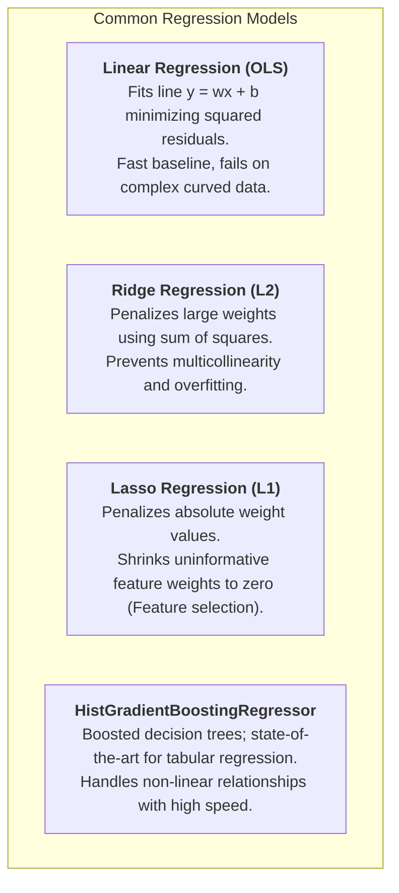

### 7.2 End-to-End Regression Example

Let's predict California housing median house values:

```python
from sklearn.datasets import fetch_california_housing
from sklearn.model_selection import train_test_split
from sklearn.ensemble import HistGradientBoostingRegressor
from sklearn.metrics import mean_squared_error, mean_absolute_error, r2_score

# 1. Load data
housing = fetch_california_housing()
X, y = housing.data, housing.target

X_train, X_test, y_train, y_test = train_test_split(
    X, y, test_size=0.2, random_state=42
)

# 2. Train model
reg = HistGradientBoostingRegressor(random_state=42)
reg.fit(X_train, y_train)

# 3. Predict on unseen test data
y_pred = reg.predict(X_test)

# 4. Compute Metrics
mae = mean_absolute_error(y_test, y_pred)
rmse = np.sqrt(mean_squared_error(y_test, y_pred))
r2 = r2_score(y_test, y_pred)

print(f"=== Regression Results ===")
print(f"Mean Absolute Error (MAE):     ${mae * 100_000:.2f}")
print(f"Root Mean Squared Error (RMSE): ${rmse * 100_000:.2f}")
print(f"R² Score (Variance Explained):  {r2:.4f}")
```

### 7.3 Regression Evaluation Metrics Explained

- **MAE (Mean Absolute Error):** Average absolute difference between prediction and actual. If MAE is $\$15,000$, your model is on average off by $\$15,000$.
- **RMSE (Root Mean Squared Error):** Penalizes large mistakes much more severely than small ones because differences are squared.
- **$R^2$ Score (Coefficient of Determination):**
  - $R^2 = 1.0$: Perfect predictions.
  - $R^2 = 0.0$: The model performs no better than simply predicting the average value for every sample.
  - $R^2 < 0.0$: The model is worse than predicting the mean!

---

## 8. Unsupervised Learning: Clustering & Dimensionality Reduction

Unsupervised learning finds hidden structure without pre-existing target labels ($y$).

### 8.1 K-Means Clustering

K-Means partitions data into $K$ distinct clusters by minimizing the distance between data points and the cluster center (centroid).

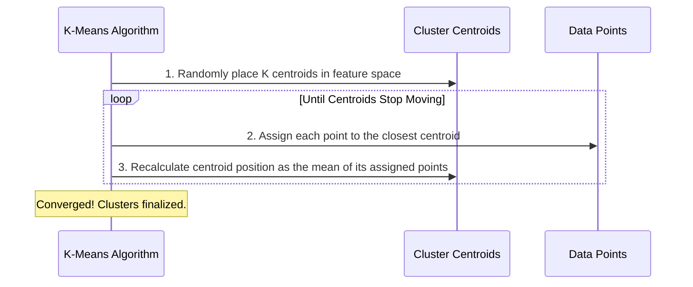

```python
from sklearn.datasets import make_blobs
from sklearn.cluster import KMeans
from sklearn.metrics import silhouette_score

# 1. Generate synthetic customer data with 3 natural clusters
X_synth, _ = make_blobs(n_samples=500, centers=3, n_features=4, random_state=42)

# 2. Fit KMeans with 3 clusters
kmeans = KMeans(n_clusters=3, n_init="auto", random_state=42)
labels = kmeans.fit_predict(X_synth)

# 3. Evaluate cluster quality using Silhouette Score (-1 to +1, higher is better)
sil_score = silhouette_score(X_synth, labels)
print(f"K-Means Silhouette Score: {sil_score:.3f}")
print(f"Cluster Centers Shape: {kmeans.cluster_centers_.shape}")
```

### 8.2 Dimensionality Reduction with PCA (Principal Component Analysis)

When data has 20, 50, or 500 features, you cannot visualize it on a 2D screen. PCA compresses high-dimensional data into 2 or 3 principal axes while preserving the maximum possible variance.

```python
from sklearn.decomposition import PCA
from sklearn.datasets import load_digits

digits = load_digits()
X_digits = digits.data  # 64 features (8x8 pixel images)

# Compress from 64 dimensions down to 2 dimensions for visualization
pca = PCA(n_components=2)
X_reduced = pca.fit_transform(X_digits)

print(f"Original shape: {X_digits.shape}")
print(f"Compressed shape: {X_reduced.shape}")
print(f"Variance retained in 2 components: {np.sum(pca.explained_variance_ratio_):.2%}")
```

---

## 9. Model Selection, Validation & Hyperparameter Tuning

### 9.1 The Bias-Variance Tradeoff

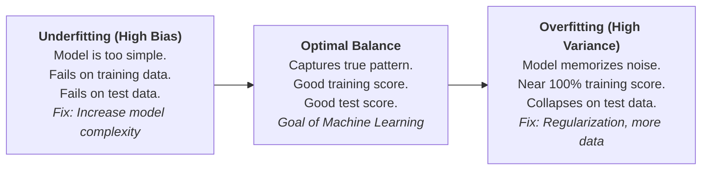

### 9.2 K-Fold Cross-Validation

Splitting data once into train/test can lead to lucky or unlucky splits. **K-Fold Cross-Validation** divides your training data into $K$ slices (folds) and trains $K$ separate models, ensuring every single sample gets evaluated.

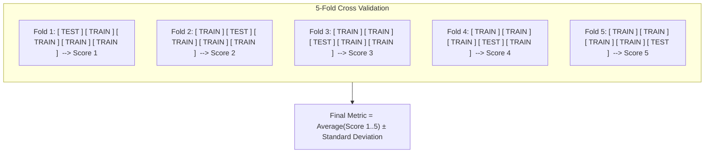

```python
from sklearn.model_selection import cross_val_score
from sklearn.ensemble import RandomForestClassifier
from sklearn.datasets import load_iris

iris = load_iris()
clf = RandomForestClassifier(random_state=42)

# Run 5-fold cross-validation
scores = cross_val_score(clf, iris.data, iris.target, cv=5, scoring="accuracy")
print(f"Cross-Validation Accuracies: {scores}")
print(f"Mean Accuracy: {scores.mean():.4f} (+/- {scores.std():.4f})")
```

### 9.3 Hyperparameter Tuning: `GridSearchCV` vs `RandomizedSearchCV`

- **Parameters:** Learned by the model during `.fit()` (e.g., weights, coefficients).
- **Hyperparameters:** Settings you configure *before* training (e.g., `n_estimators`, `max_depth`, `learning_rate`).

```python
from sklearn.model_selection import GridSearchCV
from sklearn.svm import SVC
from sklearn.datasets import load_breast_cancer

data = load_breast_cancer()
X, y = data.data, data.target

# Define the grid of candidate hyperparameters to test
param_grid = {
    "C": [0.1, 1, 10],
    "kernel": ["linear", "rbf"],
    "gamma": ["scale", "auto"]
}

# Run exhaustive search over 3 x 2 x 2 = 12 combinations with 5-fold CV (60 model trainings)
grid_search = GridSearchCV(SVC(), param_grid, cv=5, scoring="accuracy", n_jobs=-1)
grid_search.fit(X, y)

print(f"Best Hyperparameters: {grid_search.best_params_}")
print(f"Best Cross-Validation Score: {grid_search.best_score_:.4f}")
```

---

## 10. Production-Grade Scikit-Learn Pipelines

In real-world engineering, you should never run individual preprocessing steps by hand. Pack everything into a unified **Pipeline**.

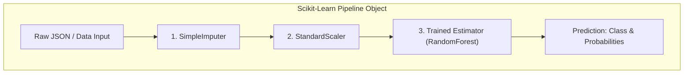

### 10.1 Building an End-to-End Leak-Proof Pipeline

```python
from sklearn.pipeline import Pipeline
from sklearn.compose import ColumnTransformer
from sklearn.preprocessing import StandardScaler, OneHotEncoder
from sklearn.impute import SimpleImputer
from sklearn.ensemble import RandomForestClassifier
import pandas as pd

# 1. Define raw data with numerical and text categorical features
df_train = pd.DataFrame({
    "age": [22, 38, 26, 35, np.nan],
    "fare": [7.25, 71.28, 7.92, 53.10, 8.05],
    "embarked": ["S", "C", "S", "S", "Q"],
    "survived": [0, 1, 1, 1, 0]
})

X = df_train.drop(columns=["survived"])
y = df_train["survived"]

# 2. Build column-specific transformations
num_pipeline = Pipeline([
    ("imputer", SimpleImputer(strategy="median")),
    ("scaler", StandardScaler())
])

cat_pipeline = Pipeline([
    ("imputer", SimpleImputer(strategy="most_frequent")),
    ("encoder", OneHotEncoder(handle_unknown="ignore", sparse_output=False))
])

preprocessor = ColumnTransformer(transformers=[
    ("num", num_pipeline, ["age", "fare"]),
    ("cat", cat_pipeline, ["embarked"])
])

# 3. Assemble the Master Pipeline
full_pipeline = Pipeline([
    ("preprocessor", preprocessor),
    ("classifier", RandomForestClassifier(n_estimators=50, random_state=42))
])

# 4. Fit the entire system in ONE call
full_pipeline.fit(X, y)

# 5. Predict directly on raw incoming JSON-style data!
new_passenger = pd.DataFrame({
    "age": [30],
    "fare": [25.0],
    "embarked": ["C"]
})

prediction = full_pipeline.predict(new_passenger)
probability = full_pipeline.predict_proba(new_passenger)
print(f"Predicted Class: {prediction[0]}")
print(f"Survival Probability: {probability[0][1]:.2%}")
```

### 10.2 Model Persistence (Saving & Loading with `joblib`)

Once trained, serialize your entire pipeline to disk for deployment:

```python
import joblib

# Save model pipeline to disk
joblib.dump(full_pipeline, "customer_classifier_v1.joblib")
print("Model saved to customer_classifier_v1.joblib")

# In production server: Load model pipeline
loaded_model = joblib.load("customer_classifier_v1.joblib")
pred = loaded_model.predict(new_passenger)
print(f"Loaded model prediction: {pred[0]}")
```

### 10.3 Serving Scikit-Learn with FastAPI

Here is a minimal, production-ready REST API endpoint serving your saved Scikit-Learn pipeline:

```python
# app.py - Run with: uvicorn app:app --reload
from fastapi import FastAPI
from pydantic import BaseModel
import pandas as pd
import joblib

app = FastAPI(title="ML Prediction Service")

# Load pipeline at server startup
model = joblib.load("customer_classifier_v1.joblib")

class PassengerPayload(BaseModel):
    age: float
    fare: float
    embarked: str

@app.post("/predict")
def predict_survival(payload: PassengerPayload):
    # Convert incoming request to DataFrame
    input_df = pd.DataFrame([payload.model_dump()])
    
    prediction = int(model.predict(input_df)[0])
    probability = float(model.predict_proba(input_df)[0][1])
    
    return {
        "prediction": prediction,
        "probability_class_1": round(probability, 4)
    }
```

---

## 11. Scikit-Learn Algorithm Selection Flowchart

Use this decision tree to pick the right estimator for your task:

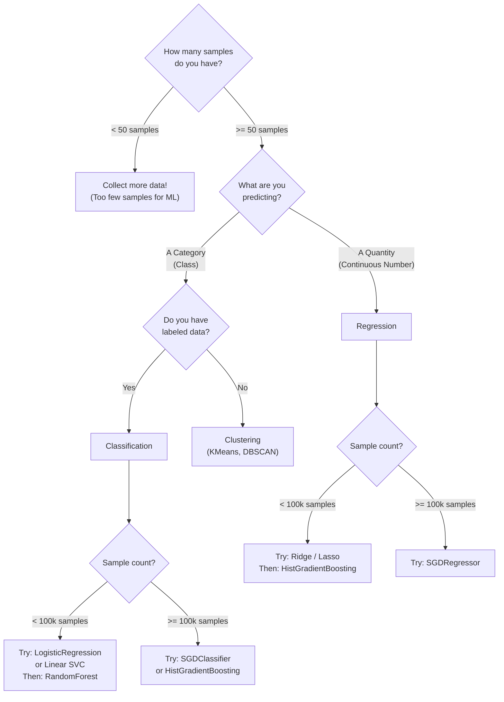

---

## 12. Top 7 Rookie Mistakes in Scikit-Learn (And How to Avoid Them)

### 1. Data Leakage (Fitting on Test Data)
- **Mistake:** Calling `scaler.fit_transform(X)` on the whole dataset *before* calling `train_test_split`.
- **Consequence:** Your model learns the mean and variance of the test set, creating overly optimistic test scores that fail in production.
- **Fix:** Split first, then fit transformers only on `X_train`. Or wrap steps inside a `Pipeline`.

### 2. Blindly Relying on Accuracy with Imbalanced Data
- **Mistake:** Using `accuracy_score` on a dataset where $98\%$ of samples belong to class 0.
- **Fix:** Always inspect `confusion_matrix`, `precision_score`, `recall_score`, and `f1_score`.

### 3. Using `LabelEncoder` on Input Features
- **Mistake:** Using `LabelEncoder` on feature columns. `LabelEncoder` is strictly designed for the 1D target vector `y`.
- **Fix:** Use `OneHotEncoder` or `OrdinalEncoder` for feature matrices $X$.

### 4. Forgetting to Set `random_state`
- **Mistake:** Omitting `random_state` when creating splits or training stochastic models (`RandomForest`, `KMeans`).
- **Consequence:** Your experiments are non-reproducible; your accuracy changes every time you re-run the script.
- **Fix:** Always specify `random_state=42` (or any fixed integer).

### 5. Passing DataFrames with Column Names to Bare NumPy Arrays
- **Mistake:** Transforming a DataFrame into a NumPy array, then later trying to access `.columns`.
- **Fix:** Scikit-Learn $\ge 1.2$ supports `set_output(transform="pandas")` on transformers to keep outputs as DataFrames!

```python
scaler = StandardScaler().set_output(transform="pandas")
df_scaled = scaler.fit_transform(X_train[["age", "fare"]])
print(type(df_scaled))  # Output: <class 'pandas.core.frame.DataFrame'>
```

### 6. Tuning Hyperparameters on the Test Set
- **Mistake:** Modifying model hyperparameters repeatedly until the test set score looks great.
- **Consequence:** You have overfitted to your test set.
- **Fix:** Use `GridSearchCV` or a separate **Validation Set** for tuning; touch the test set only once at the very end.

### 7. Neglecting Feature Scaling on Distance-Based Models
- **Mistake:** Feeding raw unscaled features directly into `KMeans`, `KNN`, `SVC`, or `LogisticRegression`.
- **Consequence:** Features with larger numbers dominate the distance metrics completely.
- **Fix:** Always include `StandardScaler` in your preprocessing pipeline.

---

## 13. Summary Checklist: The ML Engineer's Daily Workflow

```
[ ] 1. Frame the problem: Is it Classification, Regression, or Clustering?
[ ] 2. Inspect data: Check for NaNs, outliers, categorical columns, class imbalances.
[ ] 3. Split data early: X_train, X_test, y_train, y_test = train_test_split(X, y).
[ ] 4. Build a ColumnTransformer: Standardize numbers, one-hot encode text categories.
[ ] 5. Assemble a Pipeline: Combine preprocessor + estimator into one object.
[ ] 6. Train with cross-validation: Evaluate generalization via cross_val_score.
[ ] 7. Tune hyperparameters: Optimize parameters with GridSearchCV on training data.
[ ] 8. Final evaluation: Score on held-out X_test with Precision, Recall, F1, or RMSE.
[ ] 9. Serialize: joblib.dump(pipeline, "model.joblib").
[ ] 10. Deploy: Expose via FastAPI or integrate directly into your backend service.
```

