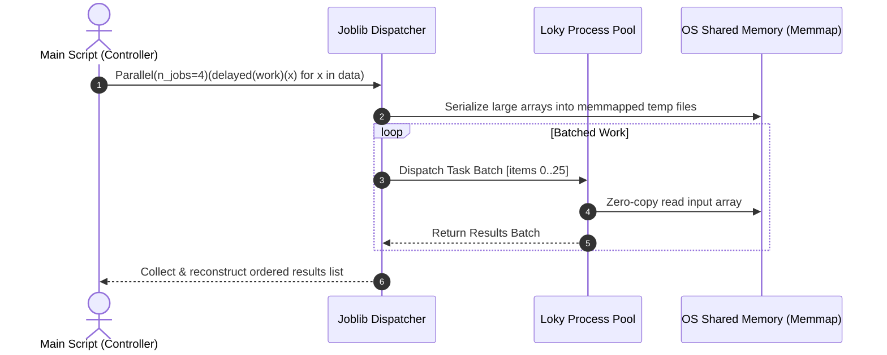
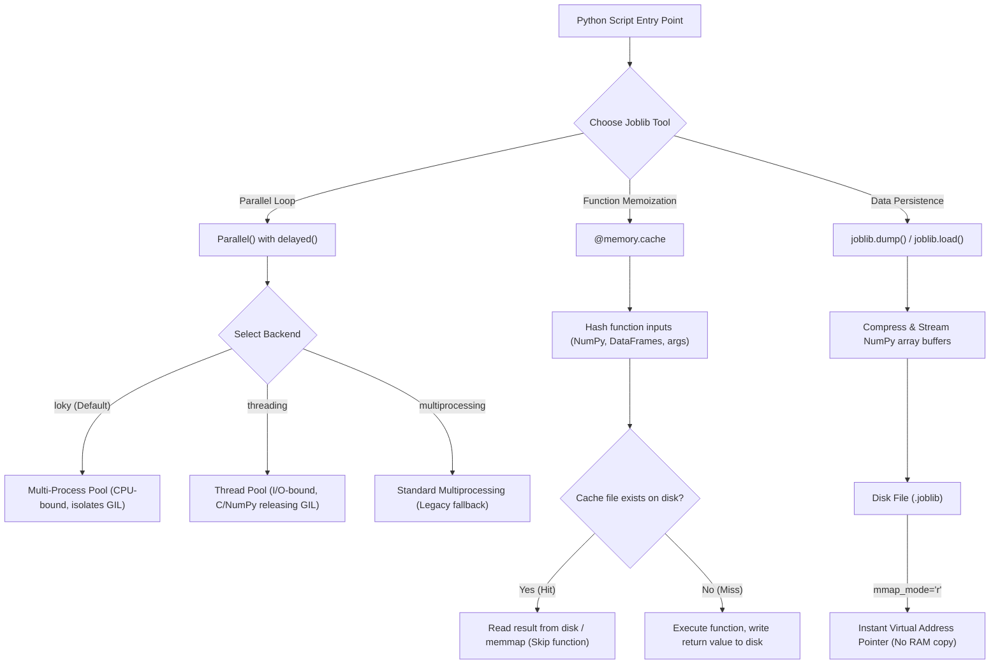
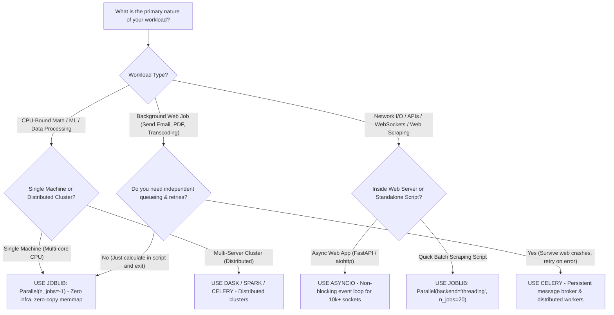

# The Definitive Guide to Joblib: From Beginner to Advanced

A comprehensive, hands-on, and visual tutorial on mastering **Joblib** for parallel computing, disk caching, and fast array persistence in Python.

---

## Table of Contents

1. [Executive Summary: What is Joblib & Why Does It Exist?](#1-executive-summary-what-is-joblib--why-does-it-exist)
   - [The 1-Minute Elevator Pitch](#the-1-minute-elevator-pitch)
   - [The Problem Joblib Solves](#the-problem-joblib-solves)
   - [The Three Pillars of Joblib](#the-three-pillars-of-joblib)
   - [The Head Chef & Prep Kitchen Analogy](#the-head-chef--prep-kitchen-analogy)
2. [Architecture & Mental Model](#2-architecture--mental-model)
   - [How Joblib Executes Code Under the Hood](#how-joblib-executes-code-under-the-hood)
   - [The Loky Process Pool vs Standard Multiprocessing](#the-loky-process-pool-vs-standard-multiprocessing)
   - [Visual Architecture Flowchart](#visual-architecture-flowchart)
3. [Pillar 1: Embarrassingly Parallel Computing (`Parallel` & `delayed`)](#3-pillar-1-embarrassingly-parallel-computing-parallel--delayed)
   - [Anatomy of the Syntax](#anatomy-of-the-syntax)
   - [What `delayed()` Actually Does](#what-delayed-actually-does)
   - [Setting `n_jobs` (Cores, -1, -2)](#setting-n_jobs-cores--1--2)
   - [The Three Execution Backends (`loky`, `threading`, `multiprocessing`)](#the-three-execution-backends-loky-threading-multiprocessing)
   - [Progress Tracking with `verbose`](#progress-tracking-with-verbose)
   - [Optimizing Chunking: `batch_size='auto'` vs Manual Batching](#optimizing-chunking-batch_sizeauto-vs-manual-batching)
   - [Preventing Memory Blowup with `pre_dispatch`](#preventing-memory-blowup-with-pre_dispatch)
   - [Streaming Lazy Results: `return_as='generator'`](#streaming-lazy-results-return_asgenerator)
   - [Context Management with `parallel_backend`](#context-management-with-parallel_backend)
4. [Pillar 2: Transparent Disk Caching (`joblib.Memory`)](#4-pillar-2-transparent-disk-caching-joblibmemory)
   - [Why `functools.lru_cache` Falls Short](#why-functools-lru_cache-falls-short)
   - [Basic Usage with `@memory.cache`](#basic-usage-with-memorycache)
   - [Cache Directory Inspection & Disk Layout](#cache-directory-inspection--disk-layout)
   - [Ignoring Volatile Arguments (`ignore=[...]`)](#ignoring-volatile-arguments-ignore)
   - [Clearing, Evicting, and Inspecting Cached Calls](#clearing-evicting-and-inspecting-cached-calls)
   - [Using `mmap_mode` with Cache Loading](#using-mmap_mode-with-cache-loading)
5. [Pillar 3: Fast Persistence & Zero-Copy Memory Mapping (`dump` & `load`)](#5-pillar-3-fast-persistence--zero-copy-memory-mapping-dump--load)
   - [Why Standard `pickle` Struggles with NumPy Arrays](#why-standard-pickle-struggles-with-numpy-arrays)
   - [Saving and Loading Objects (`joblib.dump` / `joblib.load`)](#saving-and-loading-objects-joblibdump--joblibload)
   - [Compression Algorithms & Speed vs Size Trade-offs](#compression-algorithms--speed-vs-size-trade-offs)
   - [Zero-Copy Reads via Memory Mapping (`mmap_mode`)](#zero-copy-reads-via-memory-mapping-mmap_mode)
   - [Zero-Copy Inter-Process Communication in `Parallel`](#zero-copy-inter-process-communication-in-parallel)
6. [Common Pitfalls, Edge Cases & How to Debug Them](#6-common-pitfalls-edge-cases--how-to-debug-them)
   - [Pitfall 1: Missing `if __name__ == '__main__':`](#pitfall-1-missing-if-__name__--__main__)
   - [Pitfall 2: Falling into the Python GIL Trap](#pitfall-2-falling-into-the-python-gil-trap)
   - [Pitfall 3: Serializing Lambdas and Closures](#pitfall-3-serializing-lambdas-and-closures)
   - [Pitfall 4: Thread Oversubscription (MKL / OpenBLAS Conflict)](#pitfall-4-thread-oversubscription-mkl--openblas-conflict)
   - [Pitfall 5: Cache Invalidation Gotchas](#pitfall-5-cache-invalidation-gotchas)
7. [Hands-On Labs & Practice Exercises](#7-hands-on-labs--practice-exercises)
   - [Lab 1: CPU-Bound Image/Matrix Filtering (Beginner)](#lab-1-cpu-bound-imagematrix-filtering-beginner)
   - [Lab 2: Disk-Cached Machine Learning Preprocessing (Intermediate)](#lab-2-disk-cached-machine-learning-preprocessing-intermediate)
   - [Lab 3: Zero-Copy Large Array Aggregation with Memory-Mapping (Advanced)](#lab-3-zero-copy-large-array-aggregation-with-memory-mapping-advanced)
   - [Lab 4: Memory-Efficient Streaming Parallel Generator (Advanced)](#lab-4-memory-efficient-streaming-parallel-generator-advanced)
   - [Practice Exercises with Solutions](#practice-exercises-with-solutions)
8. [The Grand Showdown: Joblib vs AsyncIO vs Celery](#8-the-grand-showdown-joblib-vs-asyncio-vs-celery)
   - [Paradigm Overview](#paradigm-overview)
   - [Detailed Feature Matrix](#detailed-feature-matrix)
   - [Joblib vs AsyncIO (CPU Concurrency vs I/O Multiplexing)](#joblib-vs-asyncio-cpu-concurrency-vs-io-multiplexing)
   - [Joblib vs Celery (Local Multiprocessing vs Distributed Queues)](#joblib-vs-celery-local-multiprocessing-vs-distributed-queues)
   - [Decision Tree Flowchart](#decision-tree-flowchart)
   - [When to Combine Them (Hybrid Architectures)](#when-to-combine-them-hybrid-architectures)
9. [Joblib Quick-Reference Cheat Sheet](#9-joblib-quick-reference-cheat-sheet)

---

## 1. Executive Summary: What is Joblib & Why Does It Exist?

### The 1-Minute Elevator Pitch

**Joblib** is an open-source Python library designed to provide **lightweight pipelining and embarrassingly parallel computing**. It requires near-zero boilerplate to transform slow, single-threaded Python loops into multi-core parallel powerhouses. It also provides automatic disk-caching for expensive function calls and ultra-fast serialization for large scientific data structures (like NumPy arrays and Pandas DataFrames).

If you have ever used `scikit-learn` and passed `n_jobs=-1`, you have already used Joblib under the hood.

```bash
pip install joblib
```

### The Problem Joblib Solves

Python's standard library offers `multiprocessing` and `pickle`, but both introduce severe friction in data science and compute-heavy workflows:

1. **The Global Interpreter Lock (GIL):** Standard Python threads cannot execute pure Python bytecode on multiple CPU cores at the same time. You need processes for true parallelism.
2. **IPC Copy Overhead:** When you send a 2 GB NumPy array to 4 worker processes using standard `multiprocessing.Pool`, Python pickles and duplicates that 2 GB array 4 times across OS IPC pipes. Your RAM spikes to 10 GB instantly!
3. **Deadlocks & Process Leaks:** Standard `fork` on Unix causes deadlocks when third-party libraries (OpenMP, CUDA, BLAS) run in background threads. If a worker crashes, processes hang indefinitely.
4. **Volatile In-Memory Caching:** Built-in `@functools.lru_cache` stores results only in RAM for the active process. When the script exits or crashes, the cache is lost. Furthermore, `lru_cache` cannot hash unhashable types like NumPy arrays or Pandas DataFrames.

**Joblib eliminates all four pain points.**

### The Three Pillars of Joblib

```
+-----------------------------------------------------------------------------------+
|                                     JOBLIB                                        |
+--------------------------+----------------------------+---------------------------+
|         PILLAR 1         |          PILLAR 2          |         PILLAR 3          |
|    PARALLEL COMPUTING    |    TRANSPARENT CACHING     |      FAST PERSISTENCE     |
| (Parallel & delayed)     |     (joblib.Memory)        |   (dump, load & memmap)   |
|                          |                            |                           |
| Run for-loops across     | Memoize function results   | Save/load large objects   |
| all CPU cores with one   | to disk. Survives script   | 10x faster than pickle    |
| line of clean code.      | restarts & re-executions.  | with zero-copy reads.     |
+--------------------------+----------------------------+---------------------------+
```

### The Head Chef & Prep Kitchen Analogy

Imagine running a high-end restaurant kitchen:

- **Single-Threaded Python:** One head chef chops 500 onions, dices 500 tomatoes, and sautés 500 steaks sequentially. Customers wait 4 hours for dinner.
- **Joblib `Parallel`:** The head chef shouts, *"5 line cooks, take 100 onions each!"* All 5 cooks chop simultaneously. The work finishes in 1/5th the time.
- **Joblib `Memory`:** The kitchen keeps pre-chopped, vacuum-sealed onions in the cold storage. If another dish asks for chopped onions with the same cut size, the chef pulls them from the fridge instead of chopping again.
- **Joblib `dump` & `load` (Memmap):** Instead of photocopying a 500-page recipe book for every cook (consuming tons of paper/RAM), the head chef opens a shared recipe ledger in the center of the kitchen. Every cook reads the same pages directly without making duplicate copies.

---

## 2. Architecture & Mental Model

### How Joblib Executes Code Under the Hood

When you dispatch a parallel loop using Joblib, it uses a generator-driven batching mechanism:



### The Loky Process Pool vs Standard Multiprocessing

By default, Joblib uses **loky** as its execution backend. Loky is a specialized process pool implementation developed by the Joblib and Scikit-Learn core teams to solve the deep flaws of standard library `multiprocessing`:

| Feature | Standard `multiprocessing.Pool` | Joblib `loky` Backend |
| :--- | :--- | :--- |
| **Process Creation** | Uses `fork` or `spawn` (can freeze with C-libraries) | Uses custom robust spawn with clean thread environment |
| **Crash Recovery** | Hangs if a worker crashes due to C/C++ segfault | Detects worker crash, terminates pool, and raises a clear Python error |
| **Process Recycling** | Can leak memory if functions accumulate state | Automatically recycles workers after memory thresholds or task counts |
| **Object Serialization** | Standard `pickle` (fails on functions defined dynamically) | Uses `cloudpickle` (can serialize functions, closures, lambdas) |
| **Large Array Handling** | Pickles and duplicates bytes over pipes | Transparently uses memory-mapped files on disk for zero-copy reads |
| **Resource Tracker** | Often leaves orphaned zombie processes | Dedicated resource tracker process guarantees cleanup on exit |

### Visual Architecture Flowchart



---

## 3. Pillar 1: Embarrassingly Parallel Computing (`Parallel` & `delayed`)

### Anatomy of the Syntax

The quintessential Joblib idiom looks like this:

```python
from joblib import Parallel, delayed
import math

results = Parallel(n_jobs=4)(delayed(math.sqrt)(i ** 2) for i in range(10))
```

At first glance, `Parallel(n_jobs=4)(delayed(...))` looks like bizarre syntax. Why are there two sets of parentheses?

1. `Parallel(n_jobs=4)` creates and configures the **executor object** (the pool).
2. The second set of parentheses invokes the `__call__` method of that executor, passing an **iterable of delayed tasks**.

### What `delayed()` Actually Does

`delayed()` is **not** a magic thread launcher. It is a deceptively simple helper function that captures a function reference along with its arguments and returns a tuple:

```python
from joblib import delayed

def compute(x, y, factor=1):
    return (x + y) * factor

# Calling delayed does NOT run compute:
item = delayed(compute)(10, 20, factor=2)

print(type(item))
print(item)
```

**Output:**
```text
<class 'tuple'>
(<function compute at 0x103cb7940>, (10, 20), {'factor': 2})
```

`delayed(func)(*args, **kwargs)` simply packages the function and its arguments into `(func, args, kwargs)`.
When the `Parallel` runner receives this stream of tuples, it picks them up, dispatches them to worker processes, and calls `func(*args, **kwargs)` inside the worker.

### Setting `n_jobs` (Cores, -1, -2)

The `n_jobs` parameter controls how many worker processes or threads run simultaneously:

```text
n_jobs = 1    -> Sequential execution in current process (great for debugging)
n_jobs = 4    -> Exactly 4 worker processes/threads
n_jobs = -1   -> Use ALL available logical CPU cores on the system
n_jobs = -2   -> Use (ALL CPU cores - 1), leaving 1 core free for OS/UI responsiveness
n_jobs = -3   -> Use (ALL CPU cores - 2)
```

> [!TIP]
> In production environments or shared development machines, use `n_jobs=-2`. This ensures that your system remains responsive to mouse clicks, background IDE indexing, and terminal commands while your heavy calculation runs.

### The Three Execution Backends (`loky`, `threading`, `multiprocessing`)

Joblib supports three built-in backends. Choosing the right backend is the single most critical decision for performance:

```python
# Specifying backend via Parallel constructor
Parallel(n_jobs=4, backend='loky')(delayed(func)(i) for i in data)
Parallel(n_jobs=4, backend='threading')(delayed(func)(i) for i in data)
```

```
+-------------------+----------------------+---------------------+---------------------------+
| Backend           | Concurrency Type     | GIL Affected?       | Best Used For             |
+-------------------+----------------------+---------------------+---------------------------+
| 'loky' (Default)  | Multiple OS Processes| NO (Bypasses GIL)   | Pure Python CPU tasks,    |
|                   |                      |                     | heavy math, ML inference  |
+-------------------+----------------------+---------------------+---------------------------+
| 'threading'       | Threads in 1 process | YES (Blocked by GIL)| I/O tasks, Network calls, |
|                   |                      |                     | NumPy/SciPy/Cython/OpenCV |
+-------------------+----------------------+---------------------+---------------------------+
| 'multiprocessing' | Multiple OS Processes| NO (Bypasses GIL)   | Legacy environments;      |
|                   |                      |                     | less robust than loky     |
+-------------------+----------------------+---------------------+---------------------------+
```

#### Hands-On Benchmark: CPU-bound vs I/O-bound

Let's verify how backends perform on CPU work vs I/O work:

```python
import time
import requests
from joblib import Parallel, delayed

# 1. CPU-Bound Task: Calculating prime-like factor sums
def cpu_heavy(n):
    count = 0
    for i in range(1, 300_000):
        count += (n * i) % 7
    return count

# 2. I/O-Bound Task: Simulating network/API calls
def io_heavy(delay):
    time.sleep(delay)
    return delay

if __name__ == '__main__':
    items = [5] * 8

    # --- CPU-BOUND BENCHMARK ---
    t0 = time.perf_counter()
    Parallel(n_jobs=4, backend='loky')(delayed(cpu_heavy)(x) for x in items)
    print(f"CPU task with 'loky' processes:     {time.perf_counter() - t0:.2f}s")

    t0 = time.perf_counter()
    Parallel(n_jobs=4, backend='threading')(delayed(cpu_heavy)(x) for x in items)
    print(f"CPU task with 'threading' (GIL!):   {time.perf_counter() - t0:.2f}s")

    # --- I/O-BOUND BENCHMARK ---
    io_items = [0.5] * 8
    t0 = time.perf_counter()
    Parallel(n_jobs=4, backend='threading')(delayed(io_heavy)(x) for x in io_items)
    print(f"I/O task with 'threading':          {time.perf_counter() - t0:.2f}s")
```

**Expected Terminal Output:**
```text
CPU task with 'loky' processes:     0.28s   <-- 4 CPU cores running in parallel!
CPU task with 'threading' (GIL!):   0.89s   <-- Blocked by GIL, effectively sequential!
I/O task with 'threading':          1.01s   <-- 8 items of 0.5s finished in 1.0s (threads sleep concurrently)
```

### Progress Tracking with `verbose`

Joblib features built-in real-time progress logging. Pass the `verbose` integer flag to `Parallel`:

```python
import time
from joblib import Parallel, delayed

def slow_square(x):
    time.sleep(0.1)
    return x * x

if __name__ == '__main__':
    # verbose=10 prints progress messages with elapsed and remaining time estimations
    results = Parallel(n_jobs=2, verbose=10)(
        delayed(slow_square)(i) for i in range(10)
    )
```

**Sample Output:**
```text
[Parallel(n_jobs=2)]: Using backend LokyBackend with 2 concurrent workers.
[Parallel(n_jobs=2)]: Done   1 tasks      | elapsed:    0.1s
[Parallel(n_jobs=2)]: Done   4 tasks      | elapsed:    0.2s
[Parallel(n_jobs=2)]: Done  10 out of  10 | elapsed:    0.5s finished
```

- `verbose=0`: Silent (default).
- `verbose=5`: Prints occasional progress updates.
- `verbose=10` or higher: Detailed timestamps and estimated remaining time.
- `verbose=50`: High-frequency debug messages for every task dispatched.

### Optimizing Chunking: `batch_size='auto'` vs Manual Batching

If you dispatch 1,000,000 tiny tasks individually, the IPC scheduling overhead will dwarf actual computation time. Joblib solves this through **batching** (bundling multiple items into a single job slice):

```
+--------------------------------------------------------------------------------+
| Dispatched Task Stream: [Task 1, Task 2, Task 3, Task 4, Task 5, Task 6, ...]  |
+--------------------------------------------------------------------------------+
                                       |
                   Joblib Automatic Batching (batch_size=3)
                                       v
        +-------------------+-------------------+-------------------+
        |      Batch 1      |      Batch 2      |      Batch 3      |
        | [Task 1, 2, 3]    | [Task 4, 5, 6]    | [Task 7, 8, 9]    |
        +-------------------+-------------------+-------------------+
                 |                   |                   |
              Worker 1            Worker 2            Worker 3
```

- `batch_size='auto'` (default): Joblib dynamically measures how long tasks take and automatically increases batch size to ensure workers spend >95% of their time computing rather than communicating.
- `batch_size=100`: Forces each worker to take exactly 100 items per batch. Useful if task durations are highly predictable and uniform.

### Preventing Memory Blowup with `pre_dispatch`

If you pass a generator that produces 50 million items, Python could exhaust all RAM trying to convert that generator into tasks before workers even start.
`pre_dispatch` restricts how many batches are prepared in memory at any given time:

```python
# pre_dispatch defaults to '2 * n_jobs'
# For 4 workers, at most 8 batches are buffered in memory ahead of time.
Parallel(n_jobs=4, pre_dispatch='2 * n_jobs')(
    delayed(process_record)(record) for record in stream_large_database()
)
```

You can set `pre_dispatch='all'` to force eager dispatching, or set a fixed number such as `pre_dispatch=16`.

### Streaming Lazy Results: `return_as='generator'`

Historically, `Parallel(...)` waited for all tasks to complete before returning a giant list. In modern Joblib, you can consume results **as they finish**, keeping memory consumption minimal:

```python
import time
from joblib import Parallel, delayed

def work(idx):
    time.sleep(0.2)
    return f"Result #{idx}"

if __name__ == '__main__':
    # Stream items lazily as an iterator!
    iterator = Parallel(n_jobs=2, return_as='generator')(
        delayed(work)(i) for i in range(6)
    )

    print("Parallel executor started...")
    for item in iterator:
        print(f"Consumed: {item}")
```

**Output:**
```text
Parallel executor started...
Consumed: Result #0
Consumed: Result #1
Consumed: Result #2
Consumed: Result #3
Consumed: Result #4
Consumed: Result #5
```

> [!NOTE]
> `return_as='generator'` preserves input order. If task #1 finishes before task #0, it will wait for #0 so the consumer receives results in the original sequence. If you do not care about order and want the fastest possible throughput, use `return_as='generator_unordered'` (Joblib 1.4+).

### Context Management with `parallel_backend`

If you are calling third-party libraries (like `scikit-learn`) that use Joblib internally, you do not have direct access to their `Parallel` calls. You can configure their backend externally using the `parallel_backend` context manager:

```python
from joblib import parallel_backend
from sklearn.ensemble import RandomForestClassifier
import numpy as np

X = np.random.randn(1000, 20)
y = np.random.randint(0, 2, 1000)

clf = RandomForestClassifier(n_estimators=100)

# Force scikit-learn's internal parallel loops to use threads instead of processes:
with parallel_backend('threading', n_jobs=4):
    clf.fit(X, y)
```

---

## 4. Pillar 2: Transparent Disk Caching (`joblib.Memory`)

### Why `functools.lru_cache` Falls Short

Python's standard library provides `@functools.lru_cache`. While great for pure algorithms like recursive Fibonacci, it fails in data science for three reasons:

```
Comparison: functools.lru_cache vs joblib.Memory
+----------------------------+-----------------------+-----------------------+
| Feature                    | functools.lru_cache   | joblib.Memory         |
+----------------------------+-----------------------+-----------------------+
| Storage Location           | In-Process RAM        | Persistent Disk / SSD |
| Survives Script Restart?   | NO (Lost on exit)     | YES (Persists on disk)|
| Handles NumPy / DataFrames | NO (Raises TypeError: | YES (Hashes array     |
|                            | unhashable type)      | contents accurately)  |
| Memory Mapping for Reads   | NO                    | YES (mmap_mode='r')   |
| Multi-Process Safe         | NO                    | YES (Atomic OS locks) |
+----------------------------+-----------------------+-----------------------+
```

### Basic Usage with `@memory.cache`

To cache a function, create a `Memory` instance pointing to a cache directory on disk and decorate your function with `@memory.cache`:

```python
import time
import numpy as np
from joblib import Memory

# Define directory where cached outputs will be stored
CACHE_DIR = "./my_cache_directory"
memory = Memory(CACHE_DIR, verbose=0)

@memory.cache
def heavy_matrix_computation(matrix, power=2):
    print(">>> Cache MISS: Running expensive computation...")
    time.sleep(1.5)  # Simulate expensive work
    return np.linalg.matrix_power(matrix, power)

if __name__ == '__main__':
    data = np.array([[1.0, 2.0], [3.0, 4.0]])

    print("--- First Call (Cold) ---")
    t0 = time.perf_counter()
    res1 = heavy_matrix_computation(data, power=3)
    print(f"Elapsed: {time.perf_counter() - t0:.4f}s\n")

    print("--- Second Call with Same Arguments (Hot) ---")
    t0 = time.perf_counter()
    res2 = heavy_matrix_computation(data, power=3)
    print(f"Elapsed: {time.perf_counter() - t0:.4f}s\n")

    assert np.array_equal(res1, res2)
```

**Output:**
```text
--- First Call (Cold) ---
>>> Cache MISS: Running expensive computation...
Elapsed: 1.5032s

--- Second Call with Same Arguments (Hot) ---
Elapsed: 0.0018s
```

The second call was **over 800x faster**. Even if you terminate the script, restart your computer, and run it tomorrow, the second call will load instantly from disk.

### Cache Directory Inspection & Disk Layout

Joblib organizes its cache directory systematically on disk:

```
my_cache_directory/
└── joblib/
    └── __main__--<script_name>/
        └── heavy_matrix_computation/
            ├── 7b1c4b2a8d3e.../        <-- SHA-1 hash of input arguments
            │   ├── metadata.json       <-- Execution duration, timestamp, arg types
            │   └── output.pkl          <-- Serialized return value
```

Let's read `metadata.json` generated by Joblib:
```json
{
  "duration": 1.5032,
  "input_args": {
    "matrix": "array([[1., 2.], [3., 4.]])",
    "power": "3"
  }
}
```

### Ignoring Volatile Arguments (`ignore=[...]`)

Sometimes a function accepts an argument that does **not** affect the computational result, such as a logger, a progress bar callback, an API token, or a timestamp. If that argument changes, Joblib would mistakenly treat it as a cache miss.

Use `ignore=[...]` to instruct Joblib to disregard those arguments when computing the input hash:

```python
import logging
from joblib import Memory

memory = Memory("./cache_dir", verbose=0)
logger = logging.getLogger("AppLogger")

@memory.cache(ignore=['logger', 'debug_mode'])
def train_model(features, target, logger=None, debug_mode=False):
    if logger:
        logger.info("Starting model training...")
    # Expensive fitting logic here...
    return {"status": "trained", "weights": [0.42, 0.98]}
```

Now, passing different logger instances or switching `debug_mode` between `True` and `False` will **not** invalidate the cached calculation.

### Clearing, Evicting, and Inspecting Cached Calls

```python
# 1. Clear the entire cache directory for all functions
memory.clear(warn=False)

# 2. Clear cache only for one specific decorated function
heavy_matrix_computation.clear(warn=False)

# 3. Check if a function call is already cached without running it
is_cached = heavy_matrix_computation.check_call_in_cache(data, power=3)
print(f"Is call cached? {is_cached}")

# 4. Call the raw function directly, bypassing cache read and write
raw_result = heavy_matrix_computation.call(data, power=3)
```

### Using `mmap_mode` with Cache Loading

When loading massive NumPy arrays from cache, loading the entire file into RAM can trigger out-of-memory errors. `joblib.Memory` supports direct memory mapping:

```python
# When cache hits, the array is mapped from disk into virtual address space
memory = Memory("./cache_dir", mmap_mode='r')

@memory.cache
def generate_huge_dataset():
    return np.ones((10000, 10000), dtype=np.float64)  # ~800 MB array
```

---

## 5. Pillar 3: Fast Persistence & Zero-Copy Memory Mapping (`dump` & `load`)

### Why Standard `pickle` Struggles with NumPy Arrays

Standard `pickle` is built for general Python object graphs. When it encounters a 10 GB contiguous block of floating-point numbers in a NumPy array, it writes byte-by-byte or small chunk representations, resulting in:
1. High serialization latency.
2. Huge memory duplication during unpickling.
3. Lack of direct memory-mapping support.

`joblib.dump` and `joblib.load` are optimized specifically for arbitrary Python objects that contain large NumPy arrays or numeric buffers.

### Saving and Loading Objects (`joblib.dump` / `joblib.load`)

```python
import joblib
import numpy as np

# A complex dictionary containing metadata and large scientific data
model_payload = {
    "version": "1.4.0",
    "hyperparameters": {"learning_rate": 0.01, "epochs": 100},
    "weights": np.random.randn(5000, 5000)  # 25,000,000 floats (~200 MB)
}

# 1. Save to disk
joblib.dump(model_payload, "model_checkpoint.joblib")
print("Model saved successfully!")

# 2. Load from disk
loaded_payload = joblib.load("model_checkpoint.joblib")
print("Weights shape:", loaded_payload["weights"].shape)
```

### Compression Algorithms & Speed vs Size Trade-offs

`joblib.dump` supports multiple compression formats via the `compress` parameter:

```python
# Format: compress=('compression_method', compression_level)
joblib.dump(model_payload, "model.joblib", compress=('zlib', 3))
```

Supported algorithms:
- `'zlib'`: Good general-purpose balance of speed and size (default if integer passed, e.g., `compress=3`).
- `'gzip'`: Highly compatible across standard tools.
- `'bz2'`: Higher compression ratio, but significantly slower.
- `'lzma'` / `'xz'`: Maximum compression ratio; slowest write speed.
- `'lz4'`: Blazing-fast compression and decompression; ideal when I/O disk bandwidth is the bottleneck (requires `pip install lz4`).

```
Persistence Benchmark (200 MB Array)
+--------------+------------------+-------------------+--------------------+
| Method       | File Size        | Save Time         | Load Time          |
+--------------+------------------+-------------------+--------------------+
| Uncompressed | 200.0 MB         | 0.12s             | 0.08s              |
| lz4 (lvl 3)  |  84.2 MB         | 0.19s             | 0.11s              |
| zlib (lvl 3) |  76.1 MB         | 0.65s             | 0.32s              |
| gzip (lvl 9) |  72.0 MB         | 1.84s             | 0.45s              |
| lzma (lvl 6) |  61.5 MB         | 4.90s             | 1.20s              |
+--------------+------------------+-------------------+--------------------+
```

### Zero-Copy Reads via Memory Mapping (`mmap_mode`)

Memory mapping (`mmap`) is one of Joblib's most powerful capabilities. It allows your program to access a file on disk as if it were loaded directly in RAM, without actually reading the entire file into physical memory up front!

```
                    HOW MEMORY MAPPING (mmap) WORKS
                    
   +--------------------------------------------------------+
   |              Virtual Memory Address Space              |
   |              [ 0x7FFF0000 ... 0x7FFFFFFF ]             |
   +--------------------------------------------------------+
                               |
             On-demand Page Faults (Only what you read!)
                               v
   +--------------------------------------------------------+
   |              Physical RAM (Only Active Pages)          |
   |                   [ 50 MB in RAM ]                     |
   +--------------------------------------------------------+
                               ^
                               | OS Kernel Paging
   +--------------------------------------------------------+
   |               Disk File: massive_data.joblib           |
   |                     [ 20 GB on SSD ]                   |
   +--------------------------------------------------------+
```

```python
import joblib
import numpy as np

# Create a large 2 GB array on disk (uncompressed!)
large_array = np.ones((500, 1000, 1000), dtype=np.float32)  # ~2 GB
joblib.dump(large_array, "large_array.joblib", compress=0)

# Instant load using memory mapping!
# mmap_mode options:
#   'r'  : Read-only (safe for multi-process sharing)
#   'r+' : Read/Write (writes persist back to the disk file!)
#   'c'  : Copy-on-write (modifications stay in local RAM, file untouched)
mmap_array = joblib.load("large_array.joblib", mmap_mode='r')

# This takes < 0.005 seconds!
print("Type:", type(mmap_array))
print("Shape:", mmap_array.shape)
print("Slice mean:", np.mean(mmap_array[0, :10, :10]))
```

> [!IMPORTANT]
> `mmap_mode` works **only** on uncompressed files (`compress=0` or default uncompressed `dump`). If a file is compressed with `gzip` or `zlib`, the OS kernel cannot map raw byte offsets directly to disk blocks.

### Zero-Copy Inter-Process Communication in `Parallel`

When using the `loky` backend with `Parallel`, Joblib automatically serializes large NumPy arrays into shared memory-mapped files under `/dev/shm` (or OS temp directories).

If you have an 8 GB dataset and pass it to 8 parallel worker processes:
- **Standard `multiprocessing.Pool`:** Copies 8 GB to each worker $\rightarrow$ $8 \times 8 = 64\text{ GB}$ RAM required $\rightarrow$ Crash!
- **Joblib `Parallel` with `loky`:** Writes once to memory-mapped temp storage $\rightarrow$ All 8 workers read the exact same physical RAM pages $\rightarrow$ Total RAM consumed remains ~8 GB!

---

## 6. Common Pitfalls, Edge Cases & How to Debug Them

### Pitfall 1: Missing `if __name__ == '__main__':`

On macOS and Windows, Python uses `spawn` instead of `fork` to start worker processes. The new Python process re-imports your script from top to bottom. If your parallel execution code is not guarded, every worker process will spawn its own workers recursively, creating a "fork bomb" that freezes your computer.

```python
# ❌ INCORRECT: Will crash or freeze on Windows and macOS
from joblib import Parallel, delayed

def square(x):
    return x * x

# DANGER: Executed by parent AND every spawned child process!
results = Parallel(n_jobs=4)(delayed(square)(i) for i in range(10))
```

```python
# ✅ CORRECT: Always guard the entry point
from joblib import Parallel, delayed

def square(x):
    return x * x

if __name__ == '__main__':
    results = Parallel(n_jobs=4)(delayed(square)(i) for i in range(10))
    print(results)
```

### Pitfall 2: Falling into the Python GIL Trap

Running pure Python CPU loops with `backend='threading'` provides **zero** speedup due to the Global Interpreter Lock (GIL).

```python
# ❌ WRONG: Threads running pure Python bytecode compete for the same GIL lock
Parallel(n_jobs=4, backend='threading')(
    delayed(pure_python_hash)(x) for x in data
)
# Result: Takes just as long (or longer due to lock contention) as 1 core!

# ✅ CORRECT: Use 'loky' for pure Python CPU work
Parallel(n_jobs=4, backend='loky')(
    delayed(pure_python_hash)(x) for x in data
)
```

*When is `backend='threading'` appropriate?*
1. When downloading URLs, scraping websites, or calling REST APIs (threads sleep while waiting for network responses).
2. When calling C-extension code that explicitly releases the GIL (e.g., `scipy.linalg`, `cv2.filter2D`, `xgboost`, `numpy.dot`).

### Pitfall 3: Serializing Lambdas and Closures

Standard `pickle` cannot serialize anonymous lambda functions or nested functions that close over local variables. While Joblib's `loky` backend uses `cloudpickle` to support most closures, passing unpicklable objects (like database connections, open file handles, or network sockets) will still fail:

```python
# ❌ INCORRECT: Cannot pickle an open socket or database cursor
import sqlite3
from joblib import Parallel, delayed

conn = sqlite3.connect("database.db")
cursor = conn.cursor()

def fetch_data(c, query_id):
    c.execute(f"SELECT * FROM table WHERE id={query_id}")
    return c.fetchall()

# Crashes with: TypeError: cannot pickle 'sqlite3.Cursor' object
Parallel(n_jobs=2)(delayed(fetch_data)(cursor, i) for i in range(10))
```

```python
# ✅ CORRECT: Establish connection inside the worker function
def fetch_data_safe(query_id):
    # Each process opens its own localized connection
    with sqlite3.connect("database.db") as conn:
        cursor = conn.cursor()
        cursor.execute("SELECT * FROM table WHERE id=?", (query_id,))
        return cursor.fetchall()

Parallel(n_jobs=2)(delayed(fetch_data_safe)(i) for i in range(10))
```

### Pitfall 4: Thread Oversubscription (MKL / OpenBLAS Conflict)

Many numeric libraries (NumPy, SciPy, PyTorch) automatically use multi-threaded BLAS libraries under the hood (Intel MKL or OpenBLAS).

If you start 8 Joblib processes, and each process internally spawns 8 BLAS threads, your computer is now juggling $8 \times 8 = 64$ active threads on an 8-core CPU! This causes severe context-switching overhead and degrades performance by 300%–500%.

```
Oversubscription Disaster:
Joblib Workers (8 Processes) x BLAS Inner Threads (8 Threads) = 64 Competing Threads
```

**Solution:** Restrict inner BLAS threads before running Joblib:

```python
import os

# Limit BLAS libraries to 1 thread per worker process
os.environ["OMP_NUM_THREADS"] = "1"
os.environ["MKL_NUM_THREADS"] = "1"
os.environ["OPENBLAS_NUM_THREADS"] = "1"

import numpy as np
from joblib import Parallel, delayed

def matrix_multiply(seed):
    rng = np.random.RandomState(seed)
    A = rng.randn(1000, 1000)
    return np.dot(A, A)

if __name__ == '__main__':
    # Now all 8 CPU cores run 8 independent matrix multiplications cleanly!
    results = Parallel(n_jobs=8)(delayed(matrix_multiply)(i) for i in range(8))
```

### Pitfall 5: Cache Invalidation Gotchas

`joblib.Memory` calculates an input hash based on the **raw source code** of the function and the **contents of the arguments**.
If you edit the docstring or add an empty comment inside the cached function, Joblib will detect that the function definition changed and trigger a cache invalidation (cache miss).

Keep your cached functions concise, dedicated strictly to data computation, and separate from UI or logging wrappers.

---

## 7. Hands-On Labs & Practice Exercises

### Lab 1: CPU-Bound Image/Matrix Filtering (Beginner)

**Goal:** Parallelize a custom 2D box-blur convolution filter over 20 images and measure the speedup ratio compared to single-threaded execution.

```python
import time
import numpy as np
from joblib import Parallel, delayed

def generate_mock_image(size=(1000, 1000)):
    return np.random.randint(0, 256, size=size, dtype=np.uint8)

def apply_box_blur(image):
    """Simple 3x3 box blur filter implemented in pure numpy."""
    padded = np.pad(image, pad_width=1, mode='edge').astype(np.float32)
    blurred = (
        padded[:-2, :-2] + padded[:-2, 1:-1] + padded[:-2, 2:] +
        padded[1:-1, :-2] + padded[1:-1, 1:-1] + padded[1:-1, 2:] +
        padded[2:, :-2] + padded[2:, 1:-1] + padded[2:, 2:]
    ) / 9.0
    return blurred.astype(np.uint8)

if __name__ == '__main__':
    images = [generate_mock_image() for _ in range(16)]
    print(f"Generated {len(images)} mock images of shape 1000x1000.")

    # 1. Sequential Execution
    t0 = time.perf_counter()
    seq_results = [apply_box_blur(img) for img in images]
    seq_time = time.perf_counter() - t0
    print(f"Sequential Execution Time: {seq_time:.2f} seconds")

    # 2. Joblib Parallel Execution (All Cores)
    t0 = time.perf_counter()
    par_results = Parallel(n_jobs=-1, verbose=5)(
        delayed(apply_box_blur)(img) for img in images
    )
    par_time = time.perf_counter() - t0
    print(f"Parallel Execution Time:   {par_time:.2f} seconds")

    speedup = seq_time / par_time
    print(f"--> Achieved {speedup:.2f}x speedup on multi-core CPU!")
```

---

### Lab 2: Disk-Cached Machine Learning Preprocessing (Intermediate)

**Goal:** Implement a feature-engineering pipeline that downloads raw tabular data, cleans missing values, applies normalization, and caches the result to disk so repeated training iterations incur zero delay.

```python
import time
import numpy as np
from joblib import Memory

cache_dir = "./ml_pipeline_cache"
memory = Memory(cache_dir, verbose=1)

@memory.cache
def extract_and_engineer_features(raw_features, scaling_factor=1.5):
    print("\n[PIPELINE] Executing expensive feature extraction...")
    time.sleep(2.0)  # Simulate expensive database extraction + math
    
    # Impute missing NaN values with column means
    col_means = np.nanmean(raw_features, axis=0)
    inds = np.where(np.isnan(raw_features))
    cleaned = raw_features.copy()
    cleaned[inds] = np.take(col_means, inds[1])
    
    # Apply standard scaling
    normalized = (cleaned - np.mean(cleaned, axis=0)) / np.std(cleaned, axis=0)
    return normalized * scaling_factor

if __name__ == '__main__':
    # Create dataset with NaNs
    dataset = np.random.randn(5000, 20)
    dataset[np.random.rand(*dataset.shape) < 0.1] = np.nan

    print("Step 1: First Run (Cache empty)")
    t0 = time.perf_counter()
    features_v1 = extract_and_engineer_features(dataset, scaling_factor=2.0)
    print(f"Step 1 completed in: {time.perf_counter() - t0:.3f}s")

    print("\nStep 2: Second Run with same parameters (Should hit disk cache)")
    t0 = time.perf_counter()
    features_v2 = extract_and_engineer_features(dataset, scaling_factor=2.0)
    print(f"Step 2 completed in: {time.perf_counter() - t0:.3f}s")

    print("\nStep 3: Third Run with modified parameter (Should miss cache)")
    t0 = time.perf_counter()
    features_v3 = extract_and_engineer_features(dataset, scaling_factor=3.5)
    print(f"Step 3 completed in: {time.perf_counter() - t0:.3f}s")

    # Clean up test cache
    memory.clear(warn=False)
    print("\nCache directory cleaned.")
```

---

### Lab 3: Zero-Copy Large Array Aggregation with Memory-Mapping (Advanced)

**Goal:** Process a 500 MB array across 4 worker processes without loading duplicate copies into physical RAM, computing column-wise statistics using memory-mapping.

```python
import os
import time
import numpy as np
import joblib
from joblib import Parallel, delayed

FILENAME = "large_matrix_mmap.joblib"

def compute_chunk_variance(matrix_mmap, row_start, row_end):
    """Computes column variances for a specific row slice without copying memory."""
    slice_data = matrix_mmap[row_start:row_end, :]
    return np.var(slice_data, axis=0)

if __name__ == '__main__':
    # 1. Create and dump a 500 MB uncompressed array
    print("Writing 500 MB dataset to disk...")
    num_rows, num_cols = 50_000, 1_250
    matrix = np.random.randn(num_rows, num_cols).astype(np.float64)
    joblib.dump(matrix, FILENAME, compress=0)
    del matrix  # Free memory from parent process

    # 2. Memory-map the array in read-only mode
    mapped_data = joblib.load(FILENAME, mmap_mode='r')
    print(f"Memory mapped array loaded with shape: {mapped_data.shape}")

    # 3. Define 4 chunk boundary ranges
    chunk_size = num_rows // 4
    slices = [(i * chunk_size, (i + 1) * chunk_size) for i in range(4)]

    # 4. Dispatch parallel computation
    t0 = time.perf_counter()
    variances = Parallel(n_jobs=4, backend='loky')(
        delayed(compute_chunk_variance)(mapped_data, start, end)
        for start, end in slices
    )
    total_time = time.perf_counter() - t0

    print(f"Computed variances across 4 chunks in {total_time:.3f} seconds.")
    print(f"Chunk 0 variance shape: {variances[0].shape}")

    # Clean up file
    if os.path.exists(FILENAME):
        os.remove(FILENAME)
```

---

### Lab 4: Memory-Efficient Streaming Parallel Generator (Advanced)

**Goal:** Process an infinite or massive stream of data records where items are processed in parallel, but consumed one by one using `return_as='generator'`, maintaining constant, near-zero RAM usage.

```python
import time
from joblib import Parallel, delayed

def stream_events(total_count=12):
    """Simulates a database or Kafka stream of incoming events."""
    for i in range(total_count):
        yield {"event_id": i, "payload": f"payload_data_{i * 10}"}

def transform_event(event):
    """Simulate CPU compute on event."""
    time.sleep(0.1)
    transformed_id = event["event_id"] ** 2
    return f"Transformed Event ID: {transformed_id} - Key: {event['payload']}"

if __name__ == '__main__':
    print("Initiating streaming parallel pipeline...")

    # By using return_as='generator', Parallel returns an active iterator!
    # pre_dispatch='2 * n_jobs' ensures we never buffer more than 4 tasks ahead.
    results_generator = Parallel(
        n_jobs=2,
        pre_dispatch='2 * n_jobs',
        return_as='generator'
    )(delayed(transform_event)(event) for event in stream_events(10))

    # Consume results as they arrive in real time
    for item in results_generator:
        print(f"Received from worker: {item}")
```

---

### Practice Exercises with Solutions

#### Exercise 1: Finding the Optimal Backend
**Question:** You have a list of 500 URLs. You want to fetch the HTTP status code of each URL. Which Joblib backend should you choose (`'loky'` or `'threading'`), what `n_jobs` should you set, and why?

<details>
<summary>👉 Click to Reveal Solution</summary>

**Solution:**
Use `backend='threading'` with a high `n_jobs` (e.g., `n_jobs=20` to `n_jobs=50`).
```python
import requests
from joblib import Parallel, delayed

urls = ["https://httpbin.org/status/200"] * 20

def check_url(url):
    return requests.get(url, timeout=5).status_code

# Threading is ideal because HTTP requests are I/O bound.
# Python threads release the GIL during network socket wait time!
statuses = Parallel(n_jobs=10, backend='threading')(
    delayed(check_url)(u) for u in urls
)
```
</details>

---

#### Exercise 2: Caching with Volatile Random Seeds
**Question:** You have a function `train_eval(dataset, seed, metrics_logger)` where `dataset` and `seed` determine the mathematical output, while `metrics_logger` is a custom class instance created anew on every run. How do you configure `@memory.cache` so that the cache is **not** broken every time a new `metrics_logger` is instantiated?

<details>
<summary>👉 Click to Reveal Solution</summary>

**Solution:**
Use the `ignore=['metrics_logger']` parameter in `@memory.cache`:
```python
from joblib import Memory

memory = Memory("./cache_ex2", verbose=0)

@memory.cache(ignore=['metrics_logger'])
def train_eval(dataset, seed, metrics_logger):
    metrics_logger.write("Calculating...")
    return (dataset.sum() * seed) % 1000
```
Joblib will hash `dataset` and `seed`, but ignore the memory address of the newly instantiated `metrics_logger`.
</details>

---

#### Exercise 3: Fixing the Fork Bomb
**Question:** Review the following code snippet. Explain why it will crash or freeze on Windows and macOS, and provide the exact two-line fix.

```python
from joblib import Parallel, delayed
import math

def compute_root(x):
    return math.sqrt(x)

results = Parallel(n_jobs=4)(delayed(compute_root)(i) for i in range(100))
print("Done!")
```

<details>
<summary>👉 Click to Reveal Solution</summary>

**Solution:**
On macOS and Windows, new processes are created via `spawn`. The spawned subprocesses re-import the file, encountering the top-level `Parallel` call again, which spawns further subprocesses in an infinite recursive explosion.

**The Fix:** Wrap the execution inside `if __name__ == '__main__':`:
```python
from joblib import Parallel, delayed
import math

def compute_root(x):
    return math.sqrt(x)

if __name__ == '__main__':
    results = Parallel(n_jobs=4)(delayed(compute_root)(i) for i in range(100))
    print("Done!")
```
</details>

---

## 8. The Grand Showdown: Joblib vs AsyncIO vs Celery

Developers frequently ask:
> *"Should I use Joblib, Python's built-in `asyncio`, or a distributed queue like `Celery`?"*

While all three tools handle concurrency, they were engineered for fundamentally different problems, architectural environments, and scaling tiers.

### Paradigm Overview

```
                        THE THREE CONCURRENCY SPECTRUMS
                        
     Single Machine (CPU-Bound)     Single Machine (I/O-Bound)      Distributed (Multi-Server)
  +-----------------------------+ +-----------------------------+ +-----------------------------+
  |           JOBLIB            | |           ASYNCIO           | |           CELERY            |
  |  Multi-Core Multiprocessing | |  Single-Thread Event Loop   | | Distributed Task Queue      |
  |  Local Shared Memory / Disk | |  Cooperative Async Sockets  | | Network Broker (RabbitMQ)   |
  |  Zero Broker Infrastructure | |  Zero Broker Infrastructure | | Requires Redis / RabbitMQ   |
  |  Data Science & ML Heavy    | |  FastAPI, Chat, WebSockets  | | Long-running Background Jobs|
  +-----------------------------+ +-----------------------------+ +-----------------------------+
```

### Detailed Feature Matrix

| Feature | `joblib` | `asyncio` | `celery` |
| :--- | :--- | :--- | :--- |
| **Primary Sweet Spot** | Local CPU-bound numeric loops, ML, and disk caching | High-concurrency network I/O, WebSockets, APIs | Distributed asynchronous background jobs across server clusters |
| **Execution Model** | Process Pool (`loky`) or Thread Pool | Single-thread cooperative event loop (`async`/`await`) | Autonomous background daemon workers running across $N$ servers |
| **Scalability Limit** | Single machine (all physical/logical CPU cores) | Single process (thousands of concurrent network sockets) | Multi-node cluster (can scale to hundreds of separate server nodes) |
| **Infrastructure Needed** | **None** (`pip install joblib`) | **None** (Built into standard Python) | **Heavy** (Requires Message Broker like RabbitMQ or Redis + DB) |
| **Bypasses Python GIL?** | **YES** (Spawns distinct OS processes) | **NO** (Runs entirely on one thread) | **YES** (Each worker runs independent processes on independent servers) |
| **Serialization Method** | `cloudpickle` + memory-mapped shared files | None needed (in-memory event loop) | JSON / Pickle sent over network via broker |
| **IPC Overhead** | **Near Zero** (Shared memory mapping) | **Zero** (Same memory address space) | **High** (Network roundtrips, broker queuing, serialization) |
| **Task Failure Behavior** | Raises exception directly in main program | Unhandled task exceptions log or cancel task | Automatically retries failed jobs with exponential backoff |
| **Result Retrieval** | Synchronous or streaming generator | `await task` or `asyncio.gather()` | Asynchronous polling via Result Backend (`AsyncResult.get()`) |
| **Task Scheduling (Cron)**| No | Limited (via `asyncio.sleep` loops) | **Yes** (Built-in via `celery-beat`) |

---

### Joblib vs AsyncIO (CPU Concurrency vs I/O Multiplexing)

#### The Fundamental Difference
- **`asyncio` is cooperative multitasking on a SINGLE thread.** It is designed for waiting on external events (waiting for PostgreSQL queries, reading HTTP responses, listening to WebSocket connections). When an `async` function waits on I/O, it yields control (`await`), allowing the CPU to process thousands of other requests. However, if you run a heavy numeric matrix loop in an `async` function, **it blocks the entire event loop**, freezing all users connected to your server!
- **`joblib` is preemptive multiprocessing across MULTIPLE CPU cores.** It spawns real OS processes that run in parallel on separate physical silicon cores. It does not require you to rewrite your functions with `async` and `await`.

#### Side-by-Side Code Comparison

##### The AsyncIO Way (Best for 1,000 Concurrent HTTP Requests)
```python
import asyncio
import httpx

async def fetch_url(client, url):
    response = await client.get(url)
    return response.status_code

async def main():
    urls = ["https://httpbin.org/delay/1"] * 50
    async with httpx.AsyncClient() as client:
        # All 50 requests run concurrently on ONE single thread!
        tasks = [fetch_url(client, u) for u in urls]
        results = await asyncio.gather(*tasks)
        print(f"Finished {len(results)} network requests.")

# Run event loop
asyncio.run(main())
```

##### The Joblib Way (Best for 50 CPU-Heavy Math Computations)
```python
from joblib import Parallel, delayed
import math

def compute_heavy_factors(n):
    return sum(math.factorial(i % 10) for i in range(100_000))

if __name__ == '__main__':
    numbers = [10_000] * 16
    # 16 CPU computations distributed across all physical processor cores!
    results = Parallel(n_jobs=-1)(
        delayed(compute_heavy_factors)(n) for n in numbers
    )
    print(f"Finished {len(results)} CPU computations.")
```

---

### Joblib vs Celery (Local Multiprocessing vs Distributed Queues)

#### The Fundamental Difference
- **Joblib is synchronous, ephemeral, and local.** You run it inside your script. When your script finishes, the Joblib pool shuts down. You do not need to install Redis, run Docker containers, or manage worker daemons.
- **Celery is asynchronous, persistent, and distributed.** Your web application (Django or FastAPI) pushes a task message to a message broker (RabbitMQ/Redis) and immediately returns an HTTP `202 Accepted` response to the user. A worker pool running on a completely separate server picks up the task from the queue, executes it over 15 minutes, and records the result in a database.

```
+-----------------------------------------------------------------------------------------+
|                                    ARCHITECTURAL COMPARISON                             |
+-----------------------------------------------------------------------------------------+

  JOBLIB (In-Process Local Execution):
  [ Python Script / Notebook ]
               |
      (Internal Fork/Spawn)
               v
      [ Local Core 1 ]  [ Local Core 2 ]  [ Local Core 3 ]  [ Local Core 4 ]
               |               |                 |                 |
               +---------------+-----------------+-----------------+
                                       |
                         (Reconstructed in Main Script)

-------------------------------------------------------------------------------------------

  CELERY (Out-of-Process Distributed Cluster):
  [ FastAPI / Django ]  --->  [ Message Broker (Redis/RabbitMQ) ]
                                          |
                        +-----------------+-----------------+
                        |                                   |
                        v                                   v
             [ Server A (Worker) ]                 [ Server B (Worker) ]
                        |                                   |
                        +-----------------+-----------------+
                                          v
                              [ Result Backend (Redis/Postgres) ]
```

---

### Decision Tree Flowchart

Use this flowchart to determine with 100% certainty which tool to reach for:



---

### When to Combine Them (Hybrid Architectures)

Real-world production systems often combine these tools to leverage their complementary strengths:

#### 1. FastAPI + Joblib (Serving ML Predictions with High Throughput)
A FastAPI web server uses `asyncio` to accept thousands of web requests concurrently. When a request requests a heavy Scikit-Learn or numeric prediction, it delegates the prediction to a Joblib-cached model running with zero-copy memory mapping:

```python
from fastapi import FastAPI
import joblib

app = FastAPI()

# Load 2 GB model once using zero-copy memory mapping:
model = joblib.load("random_forest_model.joblib", mmap_mode='r')

@app.post("/predict")
async def predict(features: list[float]):
    # asyncio handles incoming HTTP requests
    # joblib's mmap handles zero-RAM copy prediction
    prediction = model.predict([features])
    return {"prediction": int(prediction[0])}
```

#### 2. Celery + Joblib (Distributed Node executing Multi-Core Tasks)
Celery handles network queuing across 10 EC2 servers. When a Celery worker on Server #3 receives a task to analyze a 10 GB satellite image, that worker uses **Joblib** to utilize all 16 CPU cores of Server #3:

```python
# tasks.py (Celery Task)
from celery import Celery
from joblib import Parallel, delayed

app = Celery('tasks', broker='redis://localhost:6379/0')

def filter_tile(tile):
    # Heavy image math
    return tile * 0.5

@app.task
def process_satellite_scene(scene_tiles):
    # Celery distributed the task to this server.
    # Now Joblib uses all 16 local cores of this server to process tiles!
    processed = Parallel(n_jobs=-1)(delayed(filter_tile)(t) for t in scene_tiles)
    return len(processed)
```

---

## 9. Joblib Quick-Reference Cheat Sheet

### Parallel Computing (`joblib.Parallel`)

```python
from joblib import Parallel, delayed

# Standard multi-core execution (all CPU cores)
results = Parallel(n_jobs=-1)(delayed(func)(arg) for arg in items)

# Leave 1 core for OS responsiveness
results = Parallel(n_jobs=-2)(delayed(func)(arg) for arg in items)

# Threading backend for I/O tasks
results = Parallel(n_jobs=10, backend='threading')(delayed(fetch)(url) for url in urls)

# Real-time progress bar (verbose 0 to 50)
results = Parallel(n_jobs=4, verbose=10)(delayed(func)(x) for x in data)

# Memory-efficient streaming generator output
iterator = Parallel(n_jobs=4, return_as='generator')(delayed(func)(x) for x in data)

# Manual batch chunking for micro-tasks
results = Parallel(n_jobs=4, batch_size=64)(delayed(fast_func)(x) for x in data)

# Scikit-learn context backend override
with joblib.parallel_backend('loky', n_jobs=4):
    model.fit(X, y)
```

### Disk Caching (`joblib.Memory`)

```python
from joblib import Memory

memory = Memory(location="./cache_directory", verbose=0)

# Cache expensive function to disk
@memory.cache
def compute_features(df, factor=1.0):
    return df * factor

# Ignore specific arguments from cache hashing
@memory.cache(ignore=['logger', 'verbose'])
def train(data, logger=None, verbose=False):
    ...

# Check if call is already cached
memory.check_call_in_cache(compute_features, df, factor=1.0)

# Clear function cache
compute_features.clear(warn=False)

# Clear all cached functions across directory
memory.clear(warn=False)
```

### Fast Persistence & Memory Mapping (`dump` / `load`)

```python
import joblib

# Fast save (automatically optimizes NumPy arrays)
joblib.dump(my_object, "filename.joblib")

# Save with fast compression
joblib.dump(my_object, "filename.joblib", compress=('lz4', 3))

# Standard load
data = joblib.load("filename.joblib")

# Instant zero-copy memory-mapped load (uncompressed files only)
huge_array = joblib.load("uncompressed_array.joblib", mmap_mode='r')
```

---

### Summary Checklist: When to Use What?

- **Need to run a Python `for`-loop 10x faster on your laptop/server?** $\rightarrow$ `joblib.Parallel(n_jobs=-1)`
- **Function takes 5 minutes to run and you're tired of waiting every time you re-run the notebook?** $\rightarrow$ `joblib.Memory`
- **Need to save/load a 5 GB NumPy array or ML model in milliseconds?** $\rightarrow$ `joblib.dump` / `joblib.load(..., mmap_mode='r')`
- **Need to handle 10,000 simultaneous chat connections or REST requests?** $\rightarrow$ `asyncio`
- **Need to send emails, charge credit cards, or distribute jobs across 10 background servers?** $\rightarrow$ `Celery`
